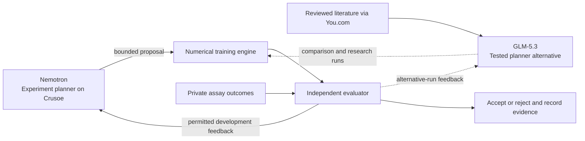
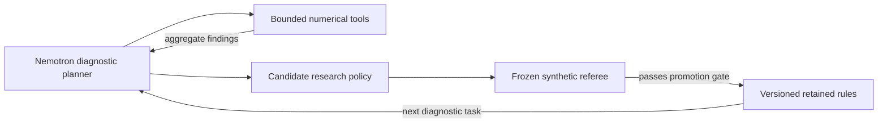

# Escape Labs

**Build the autonomous research lab that anticipates cancer's next move.**

Our ambition is to map cancer's escape routes before resistance emerges: agents that turn biological evidence into hypotheses, run experiments, improve their research methods, and help scientists decide what to test next. The long-term destination is a continuous loop between computational models and real laboratory experiments.

Escape Labs starts with published FGFR assays, Nemotron on Crusoe, numerical prediction tools, and an independent evaluator. Every experiment contributes to a growing record of what works and what needs to change.

[Explore the demo](https://escape-lab-three.vercel.app) · [Watch the submitted video](https://www.loom.com/share/7f7cd52a924a4626af662e5e756726e3) · [Read the results](docs/RESULTS.md)

Submitted to the Recursive Agents Hackathon: **Done Means Done** and **Best Use of Nemotron**. The six-hour build and subsequent development are documented separately.

## Built in six hours

In approximately six hours, we built a working pipeline around real FGFR data:
autonomous experiment proposals, numerical training, independent verification,
and a complete experiment ledger. The prototype integrates Nemotron and GLM-5.3
on Crusoe, reviewed evidence from You.com, and sequence and structural features.

## Measured improvement from the six-hour build

On **668 FGFR2 variants** across three fixed development folds, a numerical
ranking repair improved the same sequence classifier:

| Ranking | Mean-fold high-activation AP ↑ | High-activation hits in 68 picks | Strong-activation hits |
|---|---:|---:|---:|
| Original classifier probabilities | 0.09732 | 1 / 26 | 0 / 7 |
| **Same classifier, raw decision margin** | **0.11135** | **4 / 26** | 0 / 7 |
| Historical biological tree reference | 0.07186 | 3 / 26 | 0 / 7 |

**A 14.4% relative AP gain and three additional highly activating variants found
within the same budget.** We restored ranking information lost when probabilities
rounded to 1.0, preserving the fitted coefficients. Verification took **2.92
seconds with cached features**.

The matched comparison uses development folds. [Evaluation details](docs/RESULTS.md#evaluation-notes-and-next-steps) include uncertainty, per-fold behavior, and the separate resistance-agent comparisons.

- [Results and six-hour progress](docs/RESULTS.md)
- [Complete experiment ledger](docs/EXPERIMENTS.md)
- [Archived protocols, aggregate results and checksums](docs/archive/manifest.json)
- [Reproduction and data prerequisites](docs/REPRODUCING.md)
- [Hackathon submission and demo](docs/HACKATHON.md)

The next milestone is a frozen model and research policy that earn an improvement on an independent biological assay, then help prioritize prospective laboratory experiments.

## How it works



Nemotron powered the original v1 and v2 experiment-planning runs. GLM-5.3 was
tested in the same planner role, then used in the You.com research experiments.
These are alternative planners, not a chain in which GLM directs Nemotron.

The agent proposes validated model configurations. Numerical tools perform fitting and prediction. The evaluator owns labels, split grouping, metrics, budgets and promotion rules. Commitments precede held-out scoring; rejected proposals and operational failures remain recorded. Raw outcomes do not enter proposal prompts. The separate replay vault enforces authenticated, budgeted measurement reveals.

The current implementation uses application-level controls. Deployment and evaluation boundaries are recorded in [the experiment ledger](docs/EXPERIMENTS.md).

## Development after submission

The research loop now has dedicated numerical diagnostic tools, typed policy revisions, and a separate promotion referee. Nemotron can inspect score saturation and feature shift, compare ranking scores, request a fixed sequence ablation, and stop when the evidence is sufficient. Retained policies are versioned by content hash and tested on new generated failure cases before promotion.



Live Nemotron completed the new loop in five calls. Its proposed rules passed the frozen referee on **48/48 generated failure cases**, compared with **12/48** for the initial empty policy. This tests reuse within predefined numerical failure families, separately from biological AP. [Agent implementation and run records](docs/archive/reports/agent-improvements/README.md).

The model API exposes probabilities and raw ranking scores separately. A fixed 12-fit development experiment reproduced the published scores exactly, then tested a variance floor and two sequence ablations. WT-only features reached **0.11402 AP**; mutation-delta-only features reached **0.11377 AP** with **five hits in 68 picks**. These are exploratory results on the same development folds. The variance floor stabilized scores but reduced AP to **0.05951**, so the selected model remains unchanged. [Experiment and decisions](docs/archive/reports/model-improvements/report.md).

Public-source reproduction and CI checks make this work inspectable. A fresh source-only workspace downloaded the inputs, extracted new sequence features and reproduced the headline AP and hit counts exactly in **about 101 seconds**, excluding dependency installation. The sequence environment is locked, and CI verifies archived checksums, documentation links and headline metrics. [Run the reproduction workflow](docs/REPRODUCING.md).

## Run the code checks

```sh
git clone https://github.com/Gentle-mann/escape-lab.git
cd escape-lab
uv sync --frozen --python 3.12
uv run --frozen pytest -q
uv run --frozen ruff check src tests scripts
uv run --frozen python -m escape_lab.publication_check
uv run --frozen escape-lab --help
```

Tests use synthetic fixtures; they do not require API keys or consume scientific holdouts. Data-dependent local tests may skip in a clean clone.

For a new local data installation:

```sh
uv run --frozen escape-lab prepare
uv run --frozen escape-lab status
cp .env.example .env
```

Set `CRUSOE_API_KEY` and optional `YDC_API_KEY` locally. Keep `.env` and private run traces local. The original `escape-lab prepare` downloads the eight public MAVEdb score sets. The new `escape-lab-reproduce` commands rebuild the FGFR2 headline experiment from its frozen public-source recipe; see the [reproduction workflow](docs/REPRODUCING.md).

Run the local vault service after preparing data:

```sh
uv run --frozen escape-lab serve --port 8017
```

Agent and research runs use paid/credited inference. Do not run final-evaluation commands as a demo shortcut. The original final set and S13 panel are already spent; RLY and MANO outcomes remain reserved. A new checkout does not turn a public, previously used dataset into an independent validation.

## Source map

- `src/escape_lab/`: ingestion, vault/API, numerical baselines, Crusoe agents, research gates, model comparison and biological pilots.
- `tests/`: evaluator, isolation, numerical and agent-contract checks.
- `docs/`: result interpretation, full experiment ledger and curated historical archive.
- `scripts/export_public_results.py`: aggregate-only publication export from the local research workspace.

Local data, workbooks, model weights, row-level predictions, databases and request logs are excluded. The publication manifest records hashes of the original records and sanitized copies. This repo exposes the implementation and aggregate evidence; it is not a complete redistribution of all experimental inputs.

## Attribution and licensing

Current use: preclinical assay research and experiment prioritization. Patient-specific treatment decisions are outside this implementation.

The primary FGFR source is [Tangermann and colleagues' study](https://doi.org/10.1038/s41588-025-02431-8), distributed through [MAVEdb](https://api.mavedb.org/api/v1/score-sets/urn:mavedb:00001256-a-9). See the [CAGI FGFR challenge](https://genomeinterpretation.org/cagi7-fgfr.html) for experimental criteria. Protein representations use frozen ESM2-35M; structure inputs and limitations are cited in the archived protocols.

Project code is MIT licensed. Documentation and derived aggregate measurement summaries are CC BY-SA 4.0; underlying data, pretrained weights, publications and dependencies retain their own licenses. See [LICENSE](LICENSE), [NOTICE](NOTICE), and [publication scope](docs/PUBLICATION.md).
