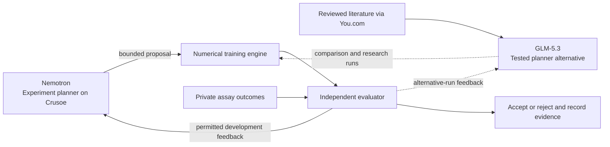

# Escape Lab

**An autonomous research workflow that proposes experiments, checks its predictions, and keeps a record of what failed.** Built for the Recursive Agents Hackathon on Crusoe Managed Inference.

The long-term ambition is to anticipate cancer's escape routes before resistance emerges. This prototype tests a smaller, falsifiable question using published FGFR assays: can research agents improve numerical predictors under an independent evaluation contract?

**Preclinical research only. No patients, medical advice, treatment recommendations, or demonstrated cancer cure.**

## Built in six hours

In approximately six hours, we built a working pipeline around real FGFR data:
autonomous experiment proposals, numerical training, independent verification,
and a complete experiment ledger. The prototype integrates Nemotron and GLM-5.3
on Crusoe, reviewed evidence from You.com, and sequence and structural features.

## Measured improvement

On **668 FGFR2 variants** across three fixed development folds, a numerical
ranking repair improved the same sequence classifier:

| Ranking | Mean-fold high-activation AP ↑ | High-activation hits in 68 picks | Strong-activation hits |
|---|---:|---:|---:|
| Original classifier probabilities | 0.09732 | 1 / 26 | 0 / 7 |
| **Same classifier, raw decision margin** | **0.11135** | **4 / 26** | 0 / 7 |
| Historical biological tree reference | 0.07186 | 3 / 26 | 0 / 7 |

**A 14.4% relative AP gain and three additional highly activating variants found
within the same budget.** We restored ranking information lost when probabilities
rounded to 1.0, preserving the fitted coefficients. Verification took **2.92
seconds with cached features**.

This is a development ranking result; its descriptive interval includes zero and
external validation remains ahead. The separate drug-resistance experiments did
not establish an LLM advantage over numerical controls. All experiments and their
evaluation details are published below.

- [Results and six-hour progress](docs/RESULTS.md)
- [Complete experiment ledger](docs/EXPERIMENTS.md)
- [Archived protocols, aggregate results and checksums](docs/archive/manifest.json)
- [Reproduction and data prerequisites](docs/REPRODUCING.md)
- [Hackathon demo and submission checklist](docs/HACKATHON.md)

Next: stronger biological representations and independent validation. Private
specialized models may perform better; we have not evaluated them.

## How it works



Nemotron powered the original v1 and v2 experiment-planning runs. GLM-5.3 was
tested in the same planner role, then used in the You.com research experiments.
These are alternative planners, not a chain in which GLM directs Nemotron.

The agent proposes validated model configurations. Numerical tools perform fitting and prediction. The evaluator owns labels, split grouping, metrics, budgets and promotion rules. Commitments precede held-out scoring; rejected proposals and operational failures remain recorded. Raw outcomes do not enter proposal prompts. The separate replay vault enforces authenticated, budgeted measurement reveals.

These are application-level controls. The prototype does not deploy NemoClaw/OpenShell or claim operating-system isolation from an adversary with filesystem access.

## Run the code checks

```sh
git clone https://github.com/Gentle-mann/escape-lab.git
cd escape-lab
uv sync --frozen --python 3.12
uv run --frozen pytest -q
uv run --frozen ruff check src tests scripts
uv run --frozen escape-lab --help
```

Tests use synthetic fixtures; they do not require API keys or consume scientific holdouts. Data-dependent local tests may skip in a clean clone.

For a new local data installation:

```sh
uv run --frozen escape-lab prepare
uv run --frozen escape-lab status
cp .env.example .env
```

Set `CRUSOE_API_KEY` and optional `YDC_API_KEY` locally. Never commit `.env` or private run traces. `prepare` downloads the original eight public MAVEdb score sets; it does **not** rebuild all later activation, sequence and structure experiments. See [reproduction limits and prerequisites](docs/REPRODUCING.md).

Run the local vault service after preparing data:

```sh
uv run --frozen escape-lab serve --port 8017
```

Agent and research runs use paid/credited inference. Do not run final-evaluation commands as a demo shortcut. The original final set and S13 panel are already spent; RLY and MANO outcomes remain reserved. A new checkout does not turn a public, previously used dataset into an independent validation.

## Source map

- `src/escape_lab/`: ingestion, vault/API, numerical baselines, Crusoe agents, research gates, model comparison and biological pilots.
- `tests/`: evaluator, isolation, numerical and agent-contract checks.
- `docs/`: result interpretation, full experiment ledger and curated historical archive.
- `scripts/export_public_results.py`: aggregate-only publication export from the local research workspace.

Local data, workbooks, model weights, row-level predictions, databases and request logs are excluded. The publication manifest records hashes of the original records and sanitized copies. This repo exposes the implementation and aggregate evidence; it is not a complete redistribution of all experimental inputs.

## Attribution and licensing

The primary FGFR source is [Tangermann and colleagues' study](https://doi.org/10.1038/s41588-025-02431-8), distributed through [MAVEdb](https://api.mavedb.org/api/v1/score-sets/urn:mavedb:00001256-a-9). See the [CAGI FGFR challenge](https://genomeinterpretation.org/cagi7-fgfr.html) for experimental criteria. Protein representations use frozen ESM2-35M; structure inputs and limitations are cited in the archived protocols.

Project code is MIT licensed. Documentation and derived aggregate measurement summaries are CC BY-SA 4.0; underlying data, pretrained weights, publications and dependencies retain their own licenses. See [LICENSE](LICENSE), [NOTICE](NOTICE), and [publication scope](docs/PUBLICATION.md).
